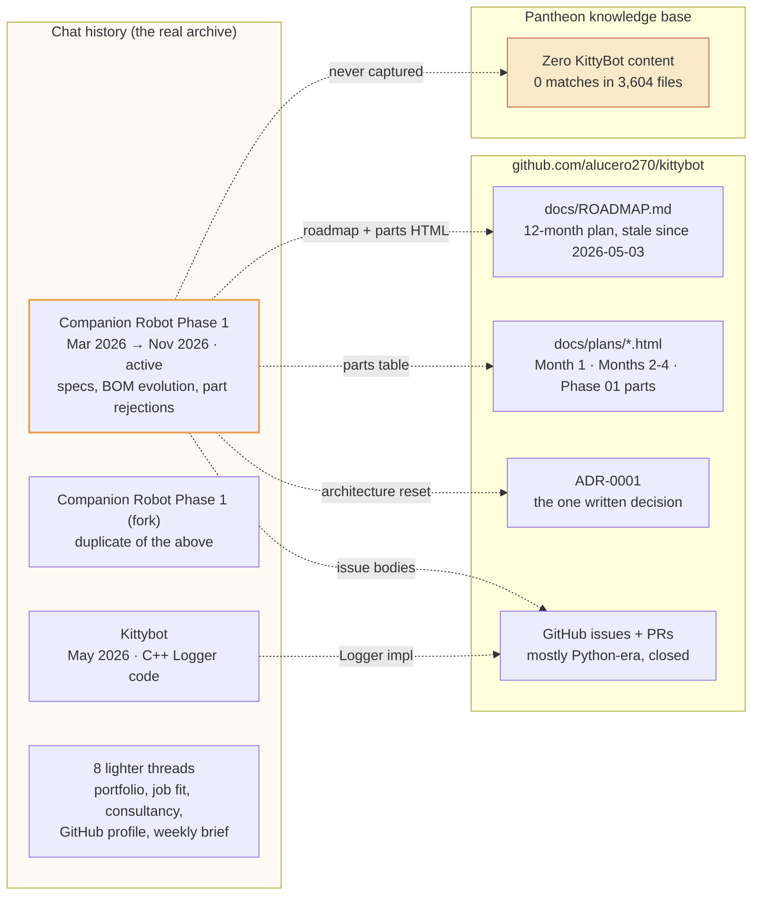
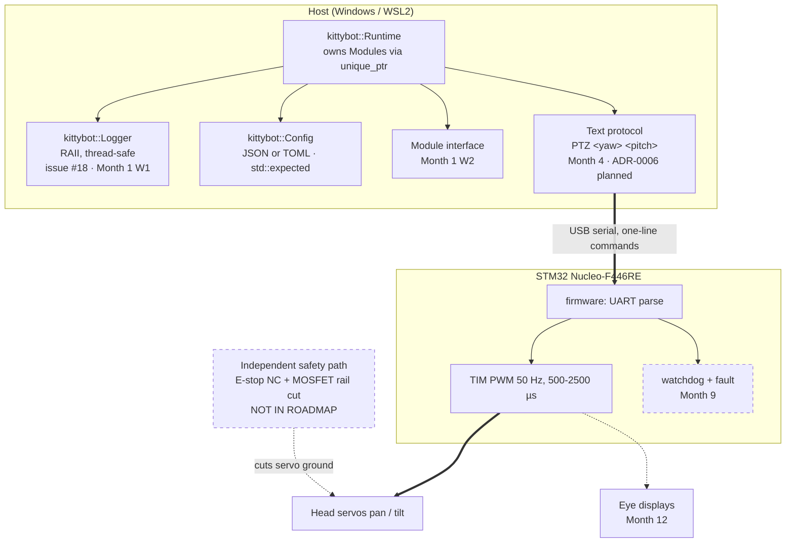
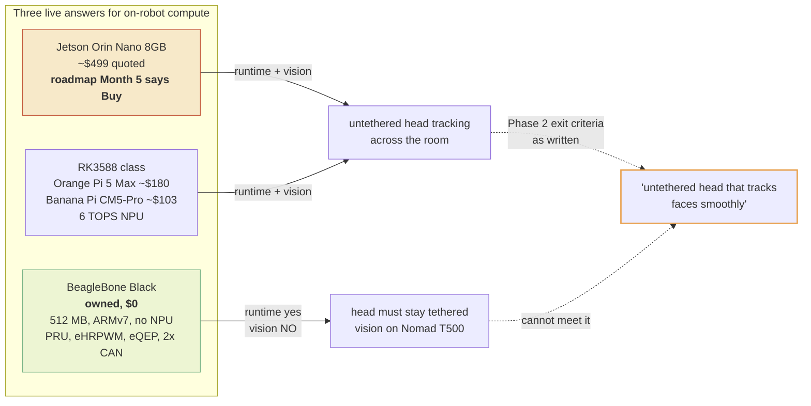
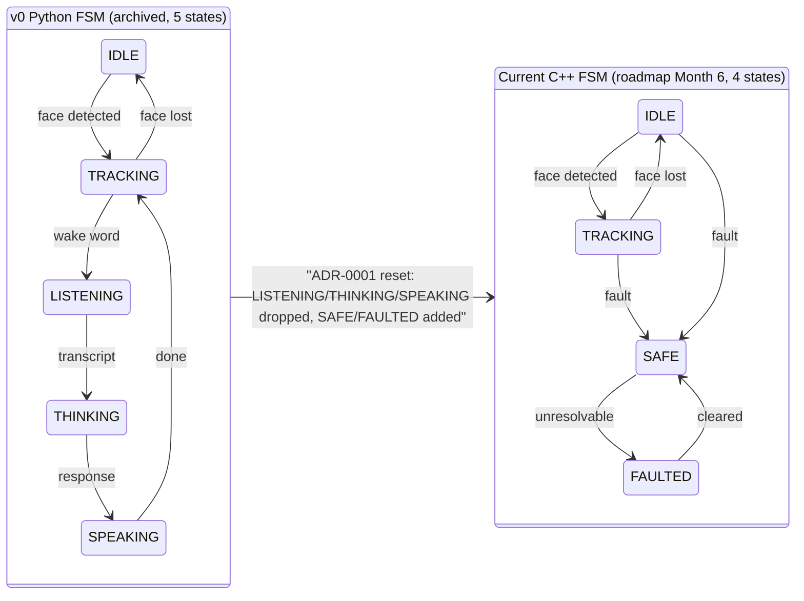
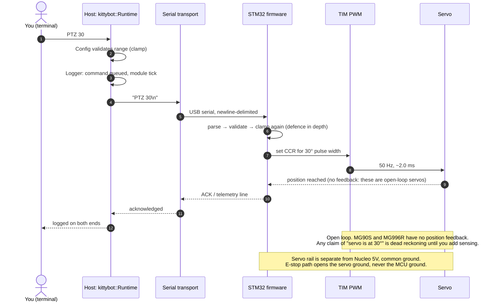
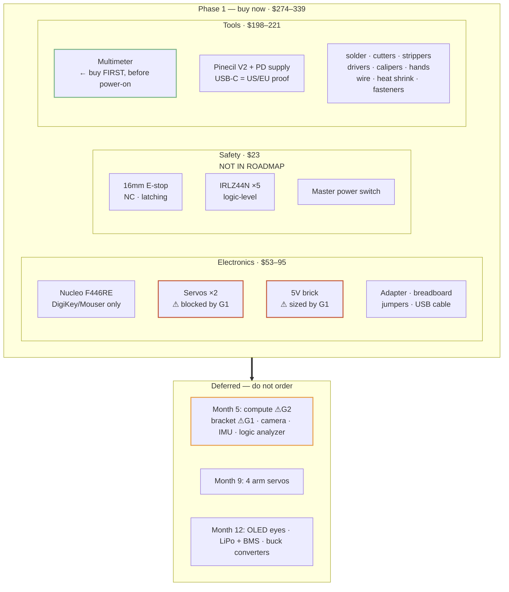

# KittyBot — Discovery, Alignment, and Documentation Proposal

**Prepared:** 2026-11-12
**Method:** Read every conversation touching this project (12 hits, 4 substantial), cloned and audited `alucero270/kittybot` at current `main`, grepped the Pantheon knowledge base (3,604 files), then diffed the three against each other.
**Deliverables in this proposal:** the gap matrix, the diagram set, and a short list of decisions only you can make.

---

## 1. Answer to "do we already have a path for repos?"

Yes. Two, and they already have a live conflict you should know about.

| Path | Status | Notes |
|---|---|---|
| `github.com/alucero270/kittybot` | **Active, canonical** | Reachable, `gh` authenticated as `alucero270` in this sandbox. Local clone now at `/home/agent/src/kittybot`. Tag `v0-python-prototype` preserves the archived Python architecture. |
| `/prometheus-data/projects/kittybot/.ai` | **Referenced, not verified** | Documented as the intended per-project `.ai` location in the Anemoi conversation. Nothing in Pantheon confirms it exists, and nothing about KittyBot is in Pantheon at all (see gap G10). |

The repo is the right home for engineering docs. It already contains `docs/decisions/` with an ADR template and an accepted ADR, so the pattern is established — do not invent a new docs location.

### What is actually in the repo right now

Twenty files, no C++ source. The honest shape:

```
CMakeLists.txt          ← C++23 configured; add_subdirectory(src) is commented out
CONTRIBUTING.md, LICENSE, .clang-format, .gitignore
.github/                ← CODEOWNERS, 4 issue templates, PR template, ci.yml (C++23 pipeline)
docs/ROADMAP.md         ← last updated 2026-05-03, still says "Week 0, pre-start, awaiting parts"
docs/decisions/         ← ADR-0000 template, ADR-0001 reset-to-C++
docs/plans/             ← MONTH-01-PLAN.html, MONTHS-02-04-PLAN.html, PHASE-01-PARTS.html
firmware/README.md      ← placeholder
hardware/README.md      ← placeholder, references BOM files that do not exist
```

Open: issue #18 (Logger), #20 (C++ skeleton), PR #21 (templates). Closed unmerged: PR #19 (Logger), whose branch `add-logger` still holds the work.

---

## 2. Where the KittyBot knowledge actually lives

Four places, none authoritative. That is the core problem this proposal addresses.



The single most consequential fact: **the entire hardware decision trail — including three parts you deliberately rejected and the reasoning — exists only in a chat transcript.** If that thread is lost, a future you re-quotes a $70 obsolete Nucleo and buys it. Two of the corrections in that thread were corrections *I* made mid-conversation, which is exactly the kind of reasoning worth committing.

---

## 3. Architecture as specified vs. architecture as shopped

The roadmap's Phase 1 and the shopping cart describe two different machines.



Dashed = specified or discussed but not scheduled. The safety path was designed in detail in conversation (NC E-stop, logic-level MOSFET switching the servo ground, MCU ground held upstream) and appears nowhere in the roadmap. It is the one part of the design that is a *physical* safety property rather than a software feature, which makes it the worst place to have a gap.

### The compute question is unresolved and it changes the Phase 2 exit criteria



Whichever you pick is a legitimate call, but the roadmap currently promises the Phase 2 outcome while the conversation's recommendation (BBB) cannot deliver it. That is gap G2, and it is the most important one in this document.

---

## 4. Behavior state machine: two versions, both live



The reset traded conversational states for safety states. Reasonable, but nobody wrote it down, and the safety states currently have no safety hardware behind them: the E-stop and MOSFET are in a shopping cart, not in a milestone, and Month 6 says "FSM (IDLE / TRACKING / SAFE / FAULTED)" with no physical path to enter SAFE.

There is also an unrecorded finding from the conversation worth promoting to spec: **cutting servo power is not automatically safe.** An unpowered head-neck goes limp and droops under gravity, potentially onto a child. SAFE needs a defined posture policy — limp against a mechanical stop, or hold-last-position with zero-rate commands — decided before the servo family is chosen, because servo mass determines how much this matters.

---

## 5. The Month 4 acceptance test, as a sequence diagram

This is the Phase 1 exit criterion, drawn so the interface it exercises is unambiguous. It is worth drawing because everything about the BOM flows through this one line.



Two properties in that diagram are load-bearing and undocumented anywhere: the double clamp (host *and* firmware, defence in depth) and the open-loop nature of these servos. The roadmap language "servo moves to 30°" quietly implies closed loop.

---

## 6. Gap matrix

Ranked by how much damage each gap does, not by effort.

| # | Gap | Evidence | Consequence | Fix |
|---|---|---|---|---|
| **G2** | **Compute node undecided, and the recommended option cannot meet the Phase 2 exit criteria** | Roadmap Month 5: "Buy: Orin Nano 8GB". Conversation (Nov 2026): use owned BeagleBone Black at $0, RK3588 if buying. Roadmap never updated. | Phase 2 promises an untethered head tracking kids across the room. BBB has no NPU and no usable GPU; Haar on Cortex-A8 is single-digit FPS. Picking BBB silently invalidates the milestone that the whole schedule is built around. | ADR-0002. Decide compute explicitly, then rewrite Phase 2 exit criteria to match. |
| **G6** | **Schedule is six months stale while the calendar moved** | ROADMAP "Last updated 2026-05-03", status "Week 0 pre-start, awaiting parts", demo target May 2027. It is now Nov 2026. | Six of twelve months are gone and no milestone has started. The May 2027 demo date is not credible. Silent drift is worse than a revised date. | Re-baseline the roadmap with real dates, or restate the target as "12 months from first commit". |
| **G1** | **Servo family conflict, and one option is a child-safety problem** | Repo parts board: MG90S ×2, 5V 3A, print brackets Month 5. Conversation cart: KEAcvise 6-pack MG996R, 5V 10A brick, 5 off-the-shelf bracket pairs. | MG996R is ~55 g and 21–40 kg·cm. That is pinch-force at a child's face. It also forces a 10A supply and different brackets. Nothing decides this. | ADR-0003. Recommend MG90S: mass and torque match a head near children, matches the existing roadmap, 3A suffices. |
| **G11** | **Two budgets in play, and the cart already busts the small one** | Roadmap: $1,500 total, expect $1,000–1,200. Conversation: "$150 to Amazon", cart grew to ~$238 and was flagged as ~$93 over. | The $150 figure was a spending instinct, not a plan, and the roadmap never acknowledged a sub-purchase at all. | Split the budget: Phase 1 parts+tools envelope, Phase 2 compute envelope. Put both in the BOM (done). |
| **G5** | **The BOM had no home in `main`** | `hardware/README.md` promises "BOM references". `hardware/bom.md` was specified in the v0 prompt and vanished in the ADR-0001 reset. The only BOM is `PHASE-01-PARTS.html`, whose checkmarks live in `localStorage`. | Procurement state is per-browser, invisible to CI, other machines, and anyone else. Zero of 18 items were marked acquired, so there is no record of what you bought. | **Fixed by this proposal:** `hardware/bom.md` + `hardware/bom.csv` added. HTML stays the pretty view; the markdown is the record. |
| **G10** | **Pantheon has zero KittyBot content** | `kittybot\|KittyBot\|kitty bot` across 3,604 KB files: no matches. | Your homelab knowledge base documents Prometheus, Ollama, OpenWebUI, and the AI stack, but not the robot that consumes it. The KittyBot ↔ Prometheus interface was designed in chat and is undiscoverable. | Decide the split: repo for engineering docs, Pantheon only for the homelab-integration interface. See recommendation R9. |
| **G9** | **Safety hardware has no milestone** | Cart contains E-stop and MOSFET discussion in detail; roadmap Phase 1 has no safety step; SAFE state is Month 6. | Software states with no physical enforcement. A kid-facing robot with a fault state that cannot be entered from the outside. | Add safety bring-up to Month 3 (it costs nothing extra: the switch and MOSFET are in the same order). Write the posture policy. |
| **G7** | **Logger work is duplicated and unowned** | Issue #18 open. PR #19 closed **unmerged**, branch `add-logger` contains `feat(logger): add logger`. "Kittybot" chat (May 2026) contains Logger test code. Month 1 Week 1 is "implement Logger". | Either you re-implement it or you throw away working code, and you will not remember which. | Review the branch, then merge or close-and-delete. Decide today; the cost is one sitting. |
| **G4** | **Bracket contradiction** | Roadmap: 3D printed, calipers bought for it. Cart: 5 pairs of MG996R robot-car brackets, "Without Screws", plus no fasteners in the order. | Brackets sized for one servo family (see G1), and unusable without an M2.5/M3 kit nobody ordered. | Resolve with G1. BOM now carries the fastener kit as T12. |
| **G3** | **Eyes: Month 12 vs first order** | Roadmap Phase 4 (Month 12): OLED eyes. Conversation: 2× SSD1306 added to the Phase 1 cart. | $14 of harm, but it shows the two plans were never reconciled. | Follow the roadmap: Month 12. Eyes are the least load-bearing item; the control loop is what needs proving. |
| **G8** | **Tracker reflects a dead architecture** | Issues #2–#12 are the Python head-service milestone (config/auth/FastAPI/Prometheus AI client), all closed. Only #18 and #20 are C++ era. Nothing exists for Months 2–4 or procurement. | GitHub shows a project that appears to have completed a milestone it actually abandoned. | Close the era with a comment, then file Months 2–4 and procurement issues. |
| **G12** | **A forked conversation duplicates the primary thread** | "Companion Robot Phase 1" and "Companion Robot Phase 1 (fork)", both active within 24 hours of each other. | Future searches split findings across two transcripts, guaranteeing partial reads. | Consolidate into one thread going forward. |

---

## 7. Procurement status, as tracked

The parts board rendered zero acquired. Whether that reflects reality or browser state is unknowable from the repo, which is precisely the gap. Recorded as `to-buy` in the BOM; correct it in a PR.



### Parts rejected, and why (this is the part chat-only knowledge endangered)

| Rejected | Reason committed here so it is not re-litigated |
|---|---|
| Nucleo-F429ZI | Obsolete; the ~$70 quote was scalper markup. Its sole advantage (256 KB SRAM) solves a constraint that does not exist. |
| Nucleo-F439ZI | In stock, mild upgrade (268 KB), but Nucleo-144 pricing for Ethernet and pins this design never uses. |
| Nucleo-N657X0-Q (STM32N6) | NPU, MIPI CSI, GPU, 4.2 MB SRAM all duplicate the *compute* board's job and add nothing to servo PWM. First-generation toolchain with documented CubeMX/FSBL errata. Keep as a Month 5–6 option **only** under "do we skip the SBC entirely". |
| The 256 KB SRAM argument itself | Retracted in-conversation and retracted here: SPI bandwidth, not RAM, caps eye refresh. A 240×240×16-bit frame is ~115 KB and needs ~22–46 ms per refresh, so 128 KB with dirty-rectangle rendering is the correct design and the better lesson. |
| Black Pill / F407ZGT6 / H743 | Savings vanish once an ST-Link is added; H7's cache and clock-tree setup is a day-loser as a first ARM project. |
| PCA9685 | STM32 timers drive these servos directly. |
| ESP32 6-pack | Homelab telemetry dashboards, separate budget. WiFi does not belong in the control loop. |
| Round "OLED" | Does not exist at hobby price. The round panels in every robot-eyes build are GC9A01 round TFTs; genuine round OLEDs are SSD1336 96×96, dimmer, dearer, worse. |
| Arduino Uno as co-processor | Left out deliberately. Its one genuinely good role is an independent servo-rail supervisor watching an STM32 heartbeat line — worth revisiting at Month 9 when fault states are real. Uno→Nucleo wiring only on FT (5 V-tolerant) pins. |

---

## 8. Recommendations

Ordered. R1 is already done as part of this proposal.

| # | Action | Owner | Why now |
|---|---|---|---|
| **R1** | **Adopt `hardware/bom.md` + `bom.csv` as the procurement record.** Correct every `to-buy` to reflect what you actually bought, in a PR titled `chore(hardware): record phase 1 procurement`. | You (status values only) | Closes G5. Every future status change becomes a dated commit — that is your procurement log for free. |
| **R2** | **Resolve the servo family** and record it as ADR-0003, including the SAFE posture policy (limp vs hold-last-position, torque limits, mechanical stops). Recommend MG90S. | You | Blocks H2, H3, F2, and the safety spec. Nothing else in the order can be finalized until this is decided. |
| **R3** | **Resolve compute** as ADR-0002, then rewrite Phase 2 exit criteria to match. Recommend: BBB now at $0, vision stays on Nomad, SBC purchase deferred to Month 5 with measured frame-rate data — and state plainly that Phase 2 as currently written requires onboard vision, so choosing BBB moves that goalpost rather than meeting it. | You | G2. The one gap that can invalidate the whole plan. |
| **R4** | **Re-baseline the schedule.** Either new dates or a restated target ("Month 12 from first commit"). Six months have elapsed against a plan that still says Week 0. | You | G6. A revised date is a decision; an unedited stale date is an accident waiting to be discovered. |
| **R5** | **Settle the Logger.** Review `origin/add-logger`, then merge PR #19 or close it and delete the branch. | ~1 sitting | G7. Cheap now, confusing forever. |
| **R6** | **Add safety to the Phase 1 plan**, Month 3, alongside first servo. The E-stop and MOSFET ride along in the same order at no extra shipping cost. | You | G9. Physical safety property, kid-facing robot, currently unscheduled. |
| **R7** | **Rebuild the issue tracker around the C++ plan:** Months 2–4 and a procurement issue. Leave a closing comment on the Python-era issues naming ADR-0001 as the reason. | ~30 min | G8. Your own tracker currently tells you a lie about what was finished. |
| **R8** | **Keep diagrams in the repo.** Mermaid renders natively on GitHub, so markdown beats HTML for diagrams; keep the dark-themed HTML files for the interactive plan views. | — | Diagrams in chat are gone by next quarter. |
| **R9** | **Split documentation homes deliberately.** Repo = engineering truth (BOM, ADRs, roadmap, protocol, diagrams). Pantheon = only the KittyBot ↔ homelab interface (Prometheus AI endpoint, network, deployment), if that integration returns. Do not mirror engineering docs into the KB; one authoritative copy, one pointer. | You | G10. Mirroring creates two truths that drift, which is how this gap happened in the first place. Note: the ADR-0001 reset means the Prometheus AI integration from the Python era is *not* currently in the architecture, so this Pantheon page may not be worth writing yet. |
| **R10** | **Consolidate the forked conversation** into one thread. | You | G12. |

### Where the imported skills fit

The newly imported set maps onto this project cleanly, and the mapping is worth stating so the vocabulary stays consistent:

| Skill | Use here |
|---|---|
| **wayfinder** | The right tool for G2/R3 — compute, servo family, and schedule re-baseline are *decisions with fog around them*, not tasks. Chart one map with decision tickets (`wayfinder:grilling` for the tradeoffs, `wayfinder:research` for the board/pricing facts) rather than deciding them ad hoc. |
| **domain-modeling** | This project has drifted vocabulary across eras: PTZ, Module, Runtime, SAFE, FAULTED, head-service. A `GLOSSARY.md` plus the existing ADR directory is exactly the fix for G8. ADR-0002/0003 slot straight into `docs/decisions/`. |
| **grilling / grill-with-docs** | Use for R2 and R3 before you order anything. The servo decision is where grill-with-docs pays: it produces the ADR as a side effect. |
| **codebase-design** | Month 1 is designing `Module`, `Runtime`, `Logger`, `Config`. That's deep-module work: `Module` with `init/start/update/stop` behind one interface is the seam the whole year hangs on. Worth doing deliberately rather than letting an agent invent it. |
| **research** | Anything price- or availability-shaped. Two price quotes in the trail were wrong, one part is obsolete. Facts about the market belong in a cited research note, not in a chat reply. |
| **wizard** | STM32 toolchain bring-up on Windows (Month 2) is a procedure only you can perform — installs, drivers, ST-Link, CubeMX. A script that walks you through it beats re-explaining it. |
| **software-factory** | Premature. Your repo is 20 files with no source. Reach for this after Phase 1 exists. |

---

## 9. What I changed, and what I deliberately did not

**Added** — committed on branch `docs/hardware-bom-and-alignment` and opened as a PR:

```
hardware/bom.md      ← the BOM: part numbers, prices, status, deferrals, rejections, init resources
hardware/bom.csv     ← machine-readable twin for spreadsheet import
hardware/README.md   ← points at the BOM; records the commit-history-as-procurement-log convention
docs/PROPOSAL-alignment.md   ← this document
```

They sit on a branch, not on `main`, because `main` is protected behind PR + approval. Merging that PR is what makes R1 real; until it merges, the BOM is a proposal rather than the record.

**Not done, because they are your calls:**

- Corrected any BOM status. Everything is `to-buy` because the repo shows zero acquired and I will not guess what you bought.
- Merged anything into `main`. Branch protection requires PR + approval; a direct push would defeat it, and R1's PR is the intended path.
- Chosen the servo or the compute board. Recommended, decided not.
- Edited `docs/ROADMAP.md`. Re-baselining your timeline is R4, not something to do silently underneath you.
- Written ADR-0002 or ADR-0003. Both are real decisions with alternatives you should pick, not template-fill. Say the word and I'll draft either after you answer the question.

---

## 10. Suggested next action

Answer the servo question and the compute question, and R2/R3 unblocks the entire order, the safety spec, and the Phase 2 exit criteria in one pass. Everything else (Logger, issues, schedule text) is bookkeeping that can proceed after.
